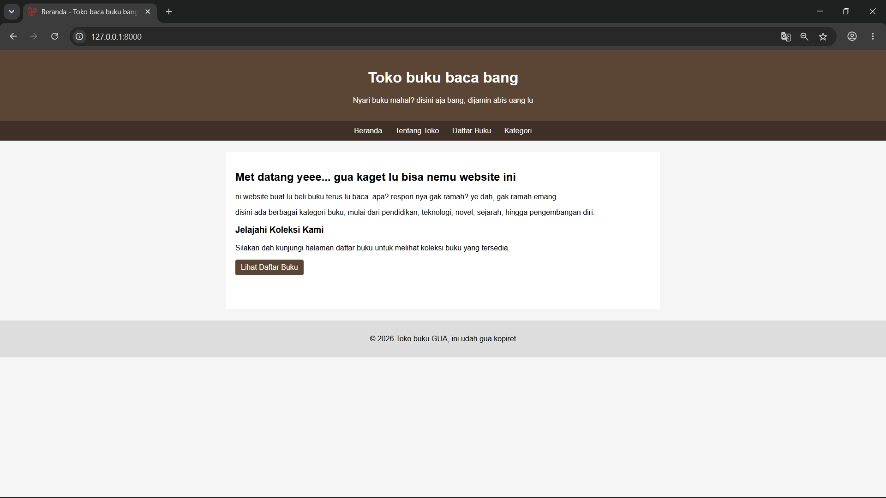
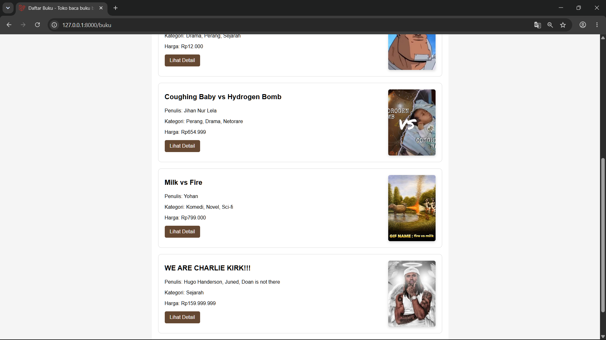
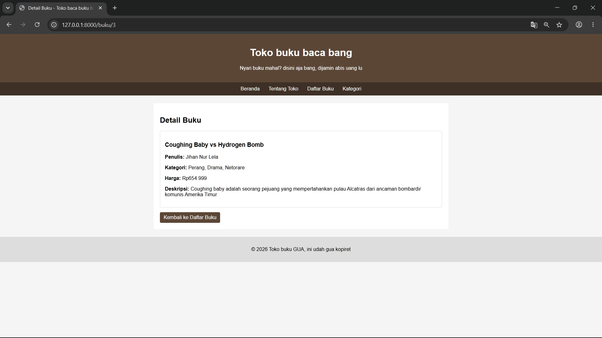
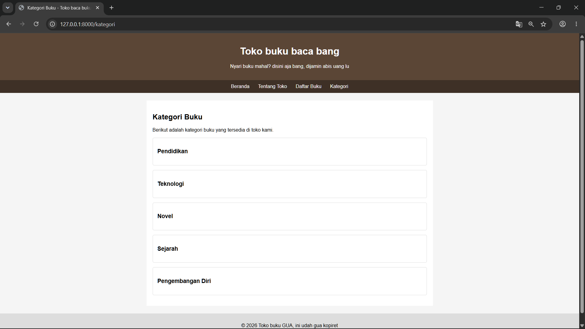
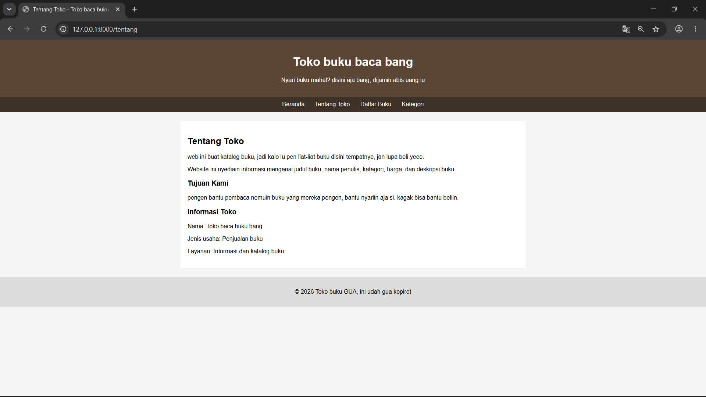

# Katalog Buku

Aplikasi web sederhana berbasis **Laravel** untuk menampilkan katalog
buku. Pengunjung dapat melihat daftar buku beserta informasi seperti
judul, penulis, kategori, harga, dan deskripsi, lalu membuka halaman
detail buku berdasarkan ID.

## Identitas Mahasiswa

-   **Nama:** Raihan Doan
-   **NIM:** C2483207005
-   **Kelas:** PTI 5A
-   **Judul/Tema:** Katalog Buku

## Fitur Aplikasi

-   Halaman Beranda
-   Halaman Tentang Toko
-   Halaman Daftar Buku
-   Halaman Kategori
-   Halaman Detail Buku berdasarkan ID
-   Navigasi ant halaman menggunakan routing Laravel
-   Data buku disimpan dalam array PHP di controller dan ditampilkan
    menggunakan Blade

## Screenshot Output

### Beranda



### Daftar Buku



### Detail Buku



### Kategori



### Tentang Toko


## Penjelasan Konsep Laravel

### 1. Routing

**Routing** menentukan URL yang dapat diakses pengguna dan
menghubungkannya ke aksi tertentu pada controller. Pada proyek ini,
route didefinisikan di `routes/web.php`, misalnya untuk halaman Beranda,
Tentang Toko, Kategori, Daftar Buku, dan Detail Buku.

Route detail buku menggunakan parameter ID, misalnya `/buku/1`, agar
aplikasi dapat menampilkan detail buku berdasarkan ID yang diminta.

### 2. Controller

**Controller** menangani alur logika aplikasi. Pada proyek ini,
controller mengatur data yang diperlukan halaman dan menentukan view
yang akan ditampilkan. Data buku disimpan sebagai array PHP, kemudian
dikirimkan ke view untuk ditampilkan. Proyek ini menggunakan pendekatan
sederhana tanpa database.

### 3. View

**View** adalah bagian tampilan yang dilihat pengguna. Pada proyek ini,
view dibuat menggunakan **Blade**, template engine bawaan Laravel. Blade
mendukung pewarisan layout, misalnya dengan `@extends`, `@section`, dan
`@yield`, serta perulangan `@foreach` untuk menampilkan daftar buku.

## Persyaratan

Pastikan perangkat sudah memiliki:

-   PHP yang sesuai dengan versi Laravel proyek ini
-   Composer
-   Laravel project dependencies
-   Browser web

## Cara Menjalankan Proyek

Langkah-langkah berikut dijalankan dari terminal pada direktori utama
proyek.

### 1. Masuk ke direktori proyek

Contoh jika proyek disimpan di Laragon:

``` bash
cd C:\laragon\www\book-catalog
```

Sesuaikan lokasi tersebut jika folder proyekmu berada di tempat lain.

### 2. Instal dependensi

``` bash
composer install
```

### 3. Siapkan file environment

Jika file `.env` belum tersedia, salin `.env.example` menjadi `.env`.

Di Windows Command Prompt:

``` bat
copy .env.example .env
```

Di Git Bash atau terminal yang mendukung perintah Unix:

``` bash
cp .env.example .env
```

### 4. Buat application key

``` bash
php artisan key:generate
```

### 5. Periksa konfigurasi sesi

Karena aplikasi katalog ini menggunakan array PHP dan tidak membutuhkan
database untuk data bukunya, sesi dapat menggunakan file. Pastikan nilai
berikut ada di `.env`:

``` env
SESSION_DRIVER=file
```

Jika file `.env` sudah memiliki baris `SESSION_DRIVER`, ubah nilainya
daripada menambahkan baris duplikat. Jika proyekmu memang membutuhkan
konfigurasi lain, ikuti konfigurasi proyek yang sudah ada.

Setelah mengubah `.env`, jalankan:

``` bash
php artisan config:clear
```

### 6. Jalankan server pengembangan

``` bash
php artisan serve
```

Buka alamat berikut di browser:

``` text
http://127.0.0.1:8000
```

Untuk menghentikan server, tekan `Ctrl + C` pada terminal yang
menjalankannya.

## Struktur Folder Penting

-   `routes/web.php` --- definisi URL atau route aplikasi.
-   `app/Http/Controllers/` --- controller dan logika halaman.
-   `resources/views/` --- template Blade untuk tampilan halaman.
-   `public/images/` --- aset gambar publik, termasuk cover buku.
-   `screenshots/` --- screenshot output aplikasi untuk dokumentasi.
-   `README.md` --- dokumentasi proyek.

## Catatan

-   Proyek ini merupakan katalog buku sederhana untuk keperluan
    pembelajaran Laravel.
-   Data buku disimpan di dalam array PHP, bukan database.
-   Jangan unggah file `.env` ke GitHub karena file tersebut dapat
    berisi konfigurasi atau informasi rahasia. Unggah `.env.example`
    jika diperlukan, bukan `.env`.
